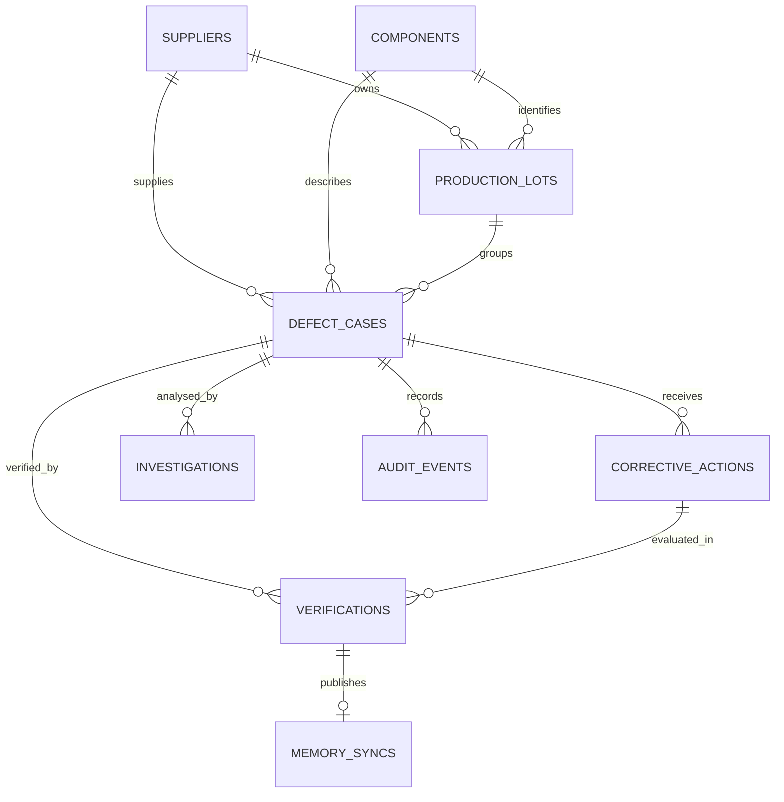
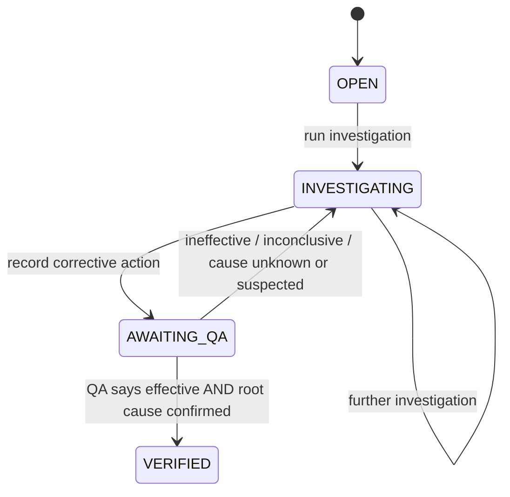

# Database Design — LotLens

Status: implemented development schema; security, migrations and production constraints remain open.

## Entity relationship diagram

## Canonical entities

| Table | Primary purpose | Important fields / constraints |
|---|---|---|
| suppliers | Supplier master | unique code, name |
| components | Component master | unique code, name |
| production_lots | Supplier/component production lot | code + supplier + component unique constraint |
| defect_cases | Canonical defect/investigation case | UUID, unique case code, supplier/component/lot FKs, symptom, severity, status, root-cause status/value, timestamps |
| corrective_actions | Proposed/attempted corrective actions | case FK, description, outcome, timestamp |
| investigations | Stored investigation query and Reflect narrative | case FK, query, output text, recall hit count, validated and unlinked case-code lists |
| verifications | QA decision for a specific action | case FK, action FK, outcome, root-cause status/value, notes, verifier |
| memory_syncs | Hindsight publish status per verification | unique verification FK, status, error summary, timestamps |
| audit_events | Append-oriented event history | case FK, actor, event type, detail, timestamp |

The SQL database is the source of truth. Hindsight stores derived experience text and is not authoritative for supplier, lot, root cause, action outcome or verification status.

## Lifecycle implemented in the first slice

The current API blocks investigation/action updates to VERIFIED cases. A new investigation for a verified case should be a separately modelled linked case/revision in a later iteration, not an overwrite.

## Evidence provenance rules implemented

1. Recall text is parsed for candidate case codes.
2. Every candidate must resolve to a canonical `defect_cases.case_code` row.
3. Only resolved canonical cases are passed to Reflect as evidence and returned as evidence cards.
4. Unmatched memory case codes are returned separately as `unlinked_case_codes`.
5. Case IDs mentioned by Reflect but not in the current canonical evidence packet are returned as `citation_warnings`.
6. This is a case-level provenance check, not yet field-level or evidence-document-level provenance. That distinction must be preserved in the UI and demo claims.

## Memory consistency

- QA verification commits to SQL first.
- A `memory_syncs` row is committed as pending in the same transaction.
- Hindsight Retain happens after the database commit.
- Success marks the row synced; failure is recorded as failed without rolling back QA verification.
- A retry route re-reads the canonical verification/action and attempts Retain again.

Remaining engineering gap: this is a synchronous post-commit attempt plus manual retry, not a durable outbox worker. A process crash between SQL commit and Hindsight Retain can leave a pending row until an operator retries. Automated reconciliation and proven idempotency are future work.

## Security and migration gaps

- No user, organisation or tenant tables; no API authentication/authorisation. Local development only.
- No row-level tenant scoping; do not deploy this API as a shared/public service.
- No evidence attachment/document tables in this slice.
- SQLAlchemy `create_all` is for fresh development databases. Add Alembic migrations before upgrading a database schema.
- SQLite is the quick-start default; PostgreSQL is supported by async URL configuration but needs an integration test against the actual deployment service.
